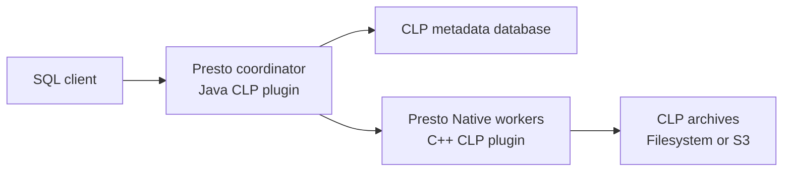

# CLP connector for Presto

Query semi-structured logs stored in CLP alongside business data stored in Parquet, in one Presto SQL query.

Presto brings together lakehouse data across sources and storage formats. Parquet works well for structured, analytical data. Logs often have evolving schemas: fields appear, disappear, or change type.

[CLP] is a storage and search system built for logs. It discovers their structure during ingestion, stores fields in separate columns, and compresses repetitive content while keeping it searchable. The CLP connector lets each dataset stay in the format that suits its workload while making it accessible through Presto SQL.

The connector supports:

* **SQL over evolving log schemas.** Query discovered columns or address fields by path and type with functions such as `CLP_GET_STRING` and `CLP_GET_BIGINT`.
* **Queries across catalogs.** Filter and aggregate logs, or join them with tables exposed by other Presto connectors.
* **Filtering and projection.** Push supported predicates into CLP, read selected columns, and use configured metadata filters to skip irrelevant archives.
* **Runtime installation.** Load a Java coordinator plugin and a C++ native worker plugin into a compatible Presto cluster.

At Uber, YScope's CLP lakehouse deployment queries logs ingested at roughly a petabyte per day, reduces their storage footprint by about 97%, and serves thousands of queries per day with five Presto workers. Read the [architecture and deployment story][presto-clp-blog] for the context behind those results.

## Query logs alongside business data

For example, an investigation can join failed trips stored in Parquet with service errors stored in CLP. With both catalogs configured, Presto reads each table through its connector and performs the join in one SQL query:

```sql
SELECT
    logs.service,
    COUNT(*) AS errors
FROM hive.rides.trips AS trips
JOIN clp.default.trip_service_logs AS logs
    ON logs.trip_id = trips.trip_id
WHERE trips.datestr = '2026-10-16'
  AND trips.status = 'FAILED'
  AND logs.response.status_code BETWEEN 500 AND 599
GROUP BY logs.service
ORDER BY errors DESC;
```

These table and column names are illustrative. This example assumes the CLP catalog exposes the referenced fields as typed columns, including a `response` object with a `status_code` field. The [local example below](#try-it-locally) uses sample data included in this repository.

## How it works



The **coordinator plugin** discovers tables and columns, rewrites CLP field-access functions into typed column references, pushes supported filters down, and selects the archives to read. The **worker plugin** reads those archives through CLP and supplies the results to Presto's Velox execution engine.

Both plugins load at startup. YScope and the Presto community extended Presto's plugin infrastructure to support this path across the Java coordinator and C++ workers. CLP is the first connector to use it end to end. The complete path shipped in Presto 0.299 and is available to other connectors as well, allowing them to be installed without rebuilding Presto.

This repository currently builds and tests against Presto 0.299; the exact source revision is pinned in [taskfile.yaml](taskfile.yaml). The native plugin must match the Presto/Velox build and CPU target of its workers.

This repository provides the query connector. A [CLP deployment][CLP] handles ingestion, compression, and the metadata that organizes archives into datasets. The connector exposes those datasets as tables in the `default` schema and requires Presto Native workers to read them.

## Getting started

| Your starting point | Setup path |
| --- | --- |
| CLP data and a Kubernetes cluster | [Deploy Presto and the connector with Helm](#deploy-with-helm) |
| An existing Presto Native cluster | [Install the plugins](#install-the-plugins) |
| You want to explore with sample logs | [Run the local example](#try-it-locally) |

### Deploy with Helm

A published Helm chart deploys a Java coordinator and native workers with both CLP plugins installed. It connects to an existing CLP metadata database and archive storage. The published chart pins the coordinator, worker, and connector images together by digest.

The chart is currently available as `0.1.0-SNAPSHOT` from the separate Helm development branch; [PR #77][helm-pr] tracks its integration into `main`. You can install it directly from the registry.

With Helm and `kubectl` configured for your cluster, create `clp-presto-values.yaml` with your CLP connection details. For archives on an existing persistent volume:

```yaml
metadataDb:
  host: "clp-metadata-db"
  port: 3306
  name: "clp-db"
  tablePrefix: "clp_"
  username: "clp_reader"
  password: "REPLACE_WITH_DATABASE_PASSWORD"

archiveStorage:
  type: "fs"
  fs:
    existingClaim: "clp-archives"
    mountPath: "/var/data/archives"
```

Replace the example values with those of your deployment. The claim must exist in the namespace where you install the chart, and the mount path must make the archive paths recorded in CLP's metadata database accessible to the workers. The volume must support access from the scheduled pods.

For S3, replace the `archiveStorage` block with:

```yaml
archiveStorage:
  type: "s3"
  s3:
    bucket: "your-clp-archives"
    regionCode: "us-east-1"
    accessKeyId: "REPLACE_WITH_ACCESS_KEY_ID"
    secretAccessKey: "REPLACE_WITH_SECRET_ACCESS_KEY"
```

For a custom S3 endpoint, set `archiveStorage.s3.endpointUrl`. See the [chart values][helm-values] for worker counts, resource settings, storage options, and metadata filters. The current snapshot renders catalog credentials into a Kubernetes ConfigMap; access to that ConfigMap grants access to those credentials.

Install the chart:

```shell
helm upgrade --install clp-presto oci://ghcr.io/y-scope/charts/clp-presto \
  --version 0.1.0-SNAPSHOT \
  --namespace clp --create-namespace \
  --values clp-presto-values.yaml \
  --wait --timeout 10m
```

The snapshot tag is updated as development continues. Retain the chart digest when you need to reproduce a particular deployment, and keep its paired Presto and connector images together.

Expose the coordinator locally, leaving this command running in a separate terminal:

```shell
kubectl --namespace clp port-forward service/clp-presto-coordinator 18080:8889
```

Connect with the [Presto CLI][presto-cli], installed as `presto` on your `PATH`:

```shell
presto --server localhost:18080 --catalog clp --schema default
```

Then run `SHOW TABLES;` to discover your datasets. The chart deploys the query engine; the tables come from the data already ingested into CLP.

### Install the plugins

For an existing Presto Native cluster, install the coordinator JAR and worker shared library into their respective nodes. Both are distributed together through an installer image and installable `.deb`, `.rpm`, and `.tar.gz` packages for Linux `amd64` and `arm64`.

The installer image is `ghcr.io/y-scope/clp-plugin-presto-connector:0.1.0-SNAPSHOT`. As an init container, it copies the plugins into a mounted directory selected by `COORDINATOR_PLUGIN_INSTALL_PATH` or `WORKER_PLUGIN_INSTALL_PATH`. It exits after installation.

To build packages and the installer image locally, clone this repository with its submodules and run `task package`. See the [packaging guide](tools/build-packages/README.md) for prerequisites, installer examples, package outputs, and CPU compatibility settings.

For a manual installation, the relevant files and settings are:

| Node | Plugin files | Setting in `etc/config.properties` |
| --- | --- | --- |
| Coordinator | `plugin/clp/clp-plugin-presto-connector.jar` | `use-connector-provided-serialization-codecs=true` |
| Native worker | `libclp-plugin-velox-connector.so` and its bundled `lib/` directory | `plugin.dir=/opt/presto-server/plugin/clp` |

The worker setting above assumes the worker plugin files are placed in `/opt/presto-server/plugin/clp`. Preserve the bundled `lib/` directory beside the shared library. The coordinator should have `node-scheduler.include-coordinator=false`, so reads go to native workers. See the integration cluster's [coordinator configuration][coordinator-config] and [worker configuration][worker-config] for complete native execution examples.

Create `etc/catalog/clp.properties` on both kinds of node. On the coordinator, configure the CLP metadata database:

```properties
connector.name=clp
clp.metadata-db-url=jdbc:mysql://clp-metadata-db:3306
clp.metadata-db-name=clp-db
clp.metadata-db-user=clp_reader
clp.metadata-db-password=REPLACE_WITH_DATABASE_PASSWORD
clp.metadata-table-prefix=clp_
```

The metadata and split providers default to MySQL. Replace the connection details and table prefix with those of your CLP deployment.

For filesystem archives, the worker catalog is:

```properties
connector.name=clp
clp.storage-type=fs
```

Every worker must be able to read the archive paths recorded in the metadata database. For S3, configure `clp.storage-type=s3`, `clp.s3-auth-provider=clp_package`, the endpoint, and credentials; the [test cluster's S3 catalog][s3-catalog] shows these properties. Configure `clp.s3-bucket` if the bucket is not already part of the archive paths. Restart the nodes after installation and configuration.

### Try it locally

The integration environment includes a Java coordinator, a native worker, and compressed sample logs. It exposes filesystem and S3 catalogs and discovers the sample datasets from the fixture directory, so you can try queries without setting up a CLP metadata database.

You need Docker with Compose and Buildx, Git, [Task] >= 3.49.1, and the standard packaging tools listed in the [packaging guide](tools/build-packages/README.md#prerequisites). To use the CLI commands below, install Java 17 and the [Presto CLI][presto-cli] as `presto` on your `PATH`. Allow at least 10 GB for the build environment, plus space for build outputs and cluster images.

```shell
git clone --recurse-submodules https://github.com/y-scope/clp-plugin-presto-connector.git
cd clp-plugin-presto-connector
task integration-tests:up
```

This builds the plugins and installer image, then starts the cluster. The first build may take some time; subsequent builds reuse cached dependencies. Once the worker has registered, connect:

```shell
presto --server localhost:18080 --catalog clp --schema default
```

Run a query against the bundled HTTP logs:

```sql
SELECT requestId, path
FROM clp.default.http_logs
WHERE method = 'POST' AND status = 200;
```

The result is one row: `req-106`, `/auth/login`.

To stop the cluster and remove its temporary plugin volumes, exit the CLI and run:

```shell
task integration-tests:down
```

See the [integration guide](integration-tests/README.md) for port overrides, test commands, and fixture details.

## Querying dynamic fields

When metadata describes a field, you can use its column name directly, including nested fields such as `event.type`. A field stored under several types may appear as separate columns, such as `timestamp_bigint` and `timestamp_double`. Use `DESCRIBE clp.default.<table>` to inspect the schema.

You can also address a field by its path and expected type without adding it to the table schema. For example, the local environment's `multi_archive` table supports:

```sql
SELECT CLP_GET_STRING('requestId'), CLP_GET_STRING('path')
FROM clp.default.multi_archive
WHERE CLP_GET_STRING('method') = 'POST'
  AND CLP_GET_BIGINT('status') = 200;
```

This returns the same `req-106`, `/auth/login` row. Other field-access functions include `CLP_GET_DOUBLE`, `CLP_GET_BOOL`, and `CLP_GET_STRING_ARRAY`. Their field paths must be constant strings. `CLP_GET_JSON_STRING()` selects the full record as JSON.

The planner rewrites these functions into typed column references. Supported predicates are translated into CLP queries, and configured metadata filters can exclude archives before they are opened. For MySQL metadata, archive pruning is configured through `clp.split-filter-config`; the Helm chart exposes it through `splitFilter`.

## Current limitations

* The connector is read-only. Ingestion and compression are handled by CLP.
* Timestamp filtering has a known correctness issue: integer-encoded timestamps can be omitted by pushed-down filters even when they display as matching timestamps. See the [documented cases](integration-tests/README.md#known-failures) before relying on these filters.

## Development

Clone with `--recurse-submodules`, or run `git submodule update --init --recursive` in an existing checkout. Run the following commands from the repository root:

| Command | Purpose |
| --- | --- |
| `task presto-connector:build` | Build the Java coordinator plugin |
| `task velox-connector:build` | Build the C++ worker plugin |
| `task package` | Build installable packages and the installer image |
| `task presto-connector:test` | Run coordinator unit tests |
| `task velox-connector:test` | Run standalone C++ unit tests |
| `task integration-tests:run` | Build, start, test, and stop a real Presto cluster |
| `task lint:check` | Run the Java, Python, and YAML checks |
| `task lint:fix` | Apply available lint fixes and run the remaining checks |

The [coordinator guide](presto-connector/README.md) and [worker guide](velox-connector/README.md) describe their build requirements. Java builds require JDK 17; native builds require a C++20 toolchain and the dependencies listed in the worker guide. The [standalone C++ tests](velox-connector/tests/README.md) cover logic independent of Velox; the integration suite covers execution through both plugins.

When adding YAML files, include their paths in the `yamllint` command in [taskfiles/lint.yaml](taskfiles/lint.yaml). Run the relevant tests and lint checks before submitting a pull request.

## Learn more and get help

* [CLP]: ingestion, compression, and the wider CLP ecosystem.
* [One Lakehouse, Many Layouts: Plugging CLP into Presto][presto-clp-blog]: architecture and the Uber deployment.
* [GitHub issues][issues]: bug reports and feature requests.
* [YScope]: discuss bringing CLP to your lakehouse.

Licensed under the [Apache License 2.0](LICENSE).

[CLP]: https://github.com/y-scope/clp
[Task]: https://taskfile.dev/docs/installation
[YScope]: https://yscope.com
[coordinator-config]: integration-tests/etc/coordinator/config.properties
[helm-pr]: https://github.com/y-scope/clp-plugin-presto-connector/pull/77
[helm-values]: https://github.com/y-scope/clp-plugin-presto-connector/blob/feat/clp-presto-helm-chart/tools/deployment/clp-presto-helm/values.yaml
[issues]: https://github.com/y-scope/clp-plugin-presto-connector/issues
[presto-cli]: https://www.prestodb.io/docs/current/clients/presto-cli.html
[presto-clp-blog]: https://github.com/y-scope/presto-blogs-collab/blob/main/presto-blog/presto-clp-final.md
[s3-catalog]: integration-tests/etc/worker/catalog/clp_s3.properties
[worker-config]: integration-tests/etc/worker/config.properties
